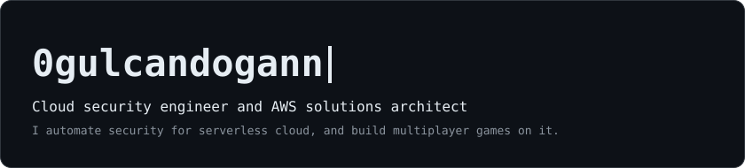
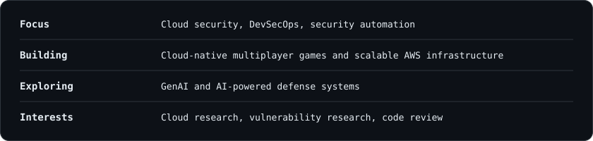
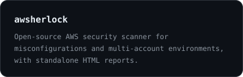
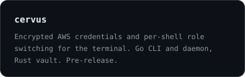
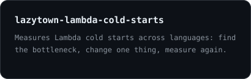
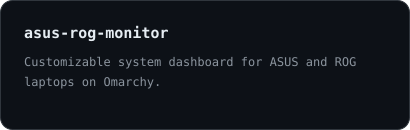
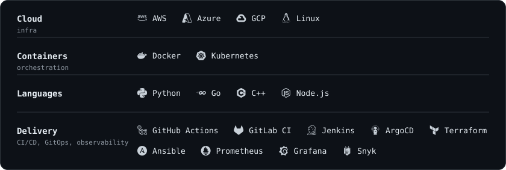

## Projects

<table>
<tr>
<td width="50%"></td>
<td width="50%"></td>
</tr>
<tr>
<td width="50%"></td>
<td width="50%"></td>
</tr>
</table>

## Tech stack

## Contact

Email [ogulcandoganzz@gmail.com](mailto:ogulcandoganzz@gmail.com) or visit [depthcloud.io](https://depthcloud.io).
